<p align="center">
  
</p>

<h3 align="center">Understanding the models. Building the systems.</h3>
<p align="center">Aspiring AI / ML Engineer · Data Science &amp; AI · DHBW Ravensburg</p>

---

### About me

I'm **Sinan**, a dual student in **Data Science and Artificial Intelligence at DHBW Ravensburg**, with practical experience in software engineering.

I'm interested in what makes intelligent systems work: the mathematics behind learning, the engineering behind reliable software, and the experiments that connect the two. My goal is to grow into an **AI / ML Engineer** who can move from a research idea to a useful implementation.

### What draws my curiosity

| Area | What I want to understand and build |
| :--- | :--- |
| **Machine Learning & Deep Learning** | Learning algorithms, optimization and meaningful model evaluation. |
| **Large Language Models** | Transformers, inference and the trade-offs behind local models. |
| **AI Agents & RAG** | Tool use, retrieval, orchestration and evaluating system behavior. |
| **ML Engineering** | Turning experiments into modular, reproducible applications. |
| **Research & Mathematics** | Reading papers, understanding assumptions and testing ideas in code. |

### My current direction

- **Build** an AI learning companion with retrieval, evaluation and progress tracking.
- **Explore** local LLM workflows with Ollama and agent orchestration with LangGraph.
- **Strengthen** my foundations in neural networks, optimization and statistics.
- **Connect** Python backends, vector search and React interfaces into useful tools.

### Tools I work with and explore

```text
LANGUAGES       Python · TypeScript · SQL
APPLICATIONS    React · FastAPI
AI SYSTEMS      LangGraph · Ollama · Qdrant
ENGINEERING     Git · Docker · OpenShift
```

### How I approach learning

**Understand the fundamentals → implement a baseline → evaluate → iterate.**

I'm especially interested in projects where machine learning meets software engineering — and where results can be measured, explained and improved.

<p align="center"><sub>Curiosity drives the questions. Experiments shape the answers.</sub></p>
