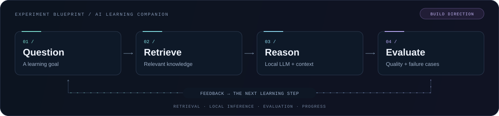

  

  <strong>Data Science &amp; AI student at DHBW Ravensburg</strong> 
  Software engineering experience. Mathematical curiosity. A growing focus on AI systems.

  <a href="#the-lab">The lab</a> &nbsp; / &nbsp;
  <a href="#current-build-direction">Build direction</a> &nbsp; / &nbsp;
  <a href="#my-toolbox">Toolbox</a> &nbsp; / &nbsp;
  <a href="https://github.com/Sinan787?tab=repositories">Repositories ↗</a>

---

### A little context

I'm **Sinan**, a dual student in **Data Science and Artificial Intelligence** with practical experience in software engineering. I'm working toward becoming an **AI / ML Engineer** who understands both the model and the system around it.

What pulls me in: turning a paper into an experiment, understanding why a model behaves the way it does, and connecting individual components into something useful.

### The lab

<table>
  <tr>
    <td width="33%" valign="top">
      <h3>01 / Understand</h3>
      <strong>The foundations of learning</strong>
      
Neural networks, optimization, statistics and the mathematics behind model behavior.

      READ → DERIVE → IMPLEMENT
    </td>
    <td width="33%" valign="top">
      <h3>02 / Experiment</h3>
      <strong>Language, retrieval &amp; agents</strong>
      
Local LLMs, grounded answers, tool use and the trade-offs behind useful AI workflows.

      PROMPT → RETRIEVE → REASON
    </td>
    <td width="33%" valign="top">
      <h3>03 / Engineer</h3>
      <strong>Systems around the model</strong>
      
Python services, vector search, interfaces and reproducible experiments with meaningful evaluation.

      BUILD → MEASURE → ITERATE
    </td>
  </tr>
</table>

### Current build direction

**An AI learning companion that connects knowledge, practice and feedback.**

The direction I'm exploring: retrieve relevant material, reason with context, evaluate the answer and use feedback to guide the next learning step.

  

- **Knowledge:** explore retrieval with Qdrant and context grounded in source material.
- **Orchestration:** experiment with local inference through Ollama and workflows in LangGraph.
- **Experience:** connect a FastAPI backend with a React interface and progress tracking.
- **Evaluation:** compare against a baseline, inspect failure cases and iterate.

### My toolbox

Technologies I work with and explore as I build my foundations:

| Layer | Tools & technologies |
| :--- | :--- |
| **Languages** | `Python` · `TypeScript` · `SQL` |
| **AI workflows** | `LangGraph` · `Ollama` · `Qdrant` |
| **Applications** | `FastAPI` · `React` |
| **Engineering** | `Git` · `Docker` · `OpenShift` |

  
<strong>How I approach a new idea</strong>

1. **Start with the question.** Understand the problem and the assumptions.
2. **Build a baseline.** Make the smallest useful experiment reproducible.
3. **Look at the failures.** Measure results and inspect where the approach breaks.
4. **Change one thing.** Test an idea, compare and keep what the evidence supports.

---

  <strong>Understand deeply. Experiment deliberately. Build with purpose.</strong> 
  Always learning. Always iterating.

